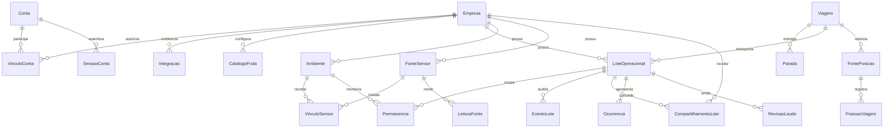

# Banco de dados e fronteiras de acesso

O banco local continua SQLite. As entidades operacionais foram acrescentadas ao esquema existente. As tabelas antigas ficam preservadas para conferência; as rotas internas antigas são desativadas ao inicializar a operação por empresa. A validação desta entrega usa SQLite; PostgreSQL não foi executado.

## Relações principais

O lote copia nome e faixa da fruta ao ser criado. Alterar o catálogo da empresa não reescreve essa faixa. A responsabilidade pode mudar sem transferir a propriedade do lote.

## Regras que preservam a rastreabilidade

- Instalações e permanências usam início inclusivo e fim exclusivo. A consulta cruza lote, ambiente, instalação e horário medido; uma leitura bruta pode atender vários lotes autorizados.
- A leitura tem chave composta por fonte e `entry_id`, com índice por fonte e horário. Posições distinguem viagem, fonte e identidade da entrada. Recebimento atrasado não muda o horário medido.
- Vínculos de conta usam conta e empresa como chave; compartilhamentos são únicos por lote e destinatário. Aceite, validade, intervalo de dados e revogação delimitam o acesso.
- Lotes, alertas e configurações relevantes usam versões. Uma alteração baseada em versão vencida gera conflito. Atualização de fase, associação e evento é transacional.
- Comandos repetíveis são identificados por empresa, ator e chave. A assinatura inclui conteúdo e política de acesso; uma resposta antiga não é reutilizada depois de reduzir direitos.
- Eventos guardam autor, empresa, fase anterior e nova, horário efetivo, horário de registro e motivo. Retratos de laudo preservam a emissão anterior.
- A migração tem marcador único e empresa explícita, exige backup íntegro e mantém IDs e códigos públicos. O histórico legado não comprova fases que o sistema anterior não registrava.

## Autenticação e autorização das rotas

As senhas usam sal e hash; sessões, convites, integrações e links secretos são validados por hash. O token de sessão é revogável. Troca de senha revoga as sessões previstas na política. Convites têm uso único e validade de dois dias.

O servidor verifica a identidade, a empresa selecionada, o vínculo ativo, o papel, a permissão da ação e o recurso referenciado. `X-Empresa-ID` apenas seleciona contexto: não concede acesso. Administração da plataforma não substitui a participação operacional na empresa. Integrações também respeitam ações e recursos autorizados.

Leituras, histórico, percurso, documentos e contagens derivadas passam pelo recorte do lote compartilhado. O cliente não recebe os outros lotes ou paradas da viagem por ter acesso a um lote.

O login limita tentativas por usuário e origem em uma janela de 15 minutos, com resposta `429` e `Retry-After`. Sessões e integrações podem expirar ou ser revogadas; os direitos atuais são conferidos nas chamadas protegidas.

O QR público dá acesso somente ao resumo. O segredo do laudo permite consulta até vencer ou ser revogado. Esses códigos não equivalem a sessão ou credencial de integração. APIs operacionais recebem credenciais em cabeçalhos; não as inclua em URLs.

O frontend mantém a sessão no armazenamento da aba e exige novo login após seu encerramento. Isso requer prevenção de scripts indevidos: a página usa política de conteúdo, módulos locais e escape dos valores exibidos. Em publicação, mantenha HTTPS, proteja o arquivo do banco e não registre caminhos de laudos secretos em logs do servidor ou proxy.

## Limites da validação

Os testes automatizados exercitam isolamento, revogação, cronologia, concorrência e repetição em SQLite. A análise térmica interrompe a integração em lacunas superiores a uma hora. Os critérios finais de selo e as políticas operacionais precisam de aprovação; um índice verde isolado não libera a carga.

O rastreio físico em celular, bloqueio de tela, montagem dos sensores e instalação em Linux precisam de ensaio nos ambientes correspondentes. As instruções e os contratos estão em [Operação por empresa](OPERACAO-POR-EMPRESA.md) e [API operacional](API-OPERACAO.md).
